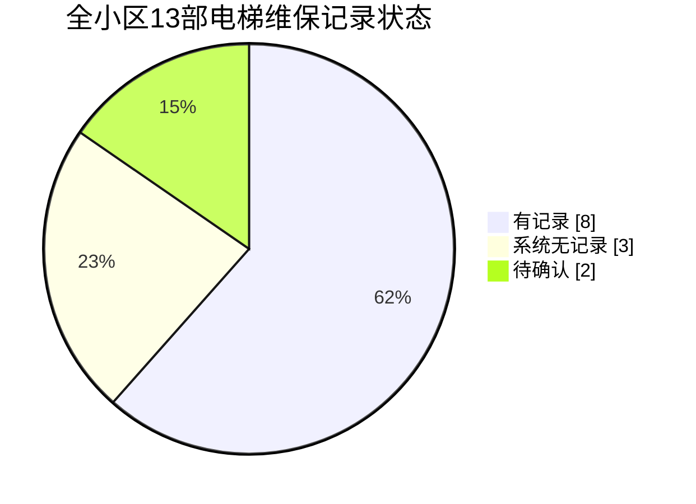
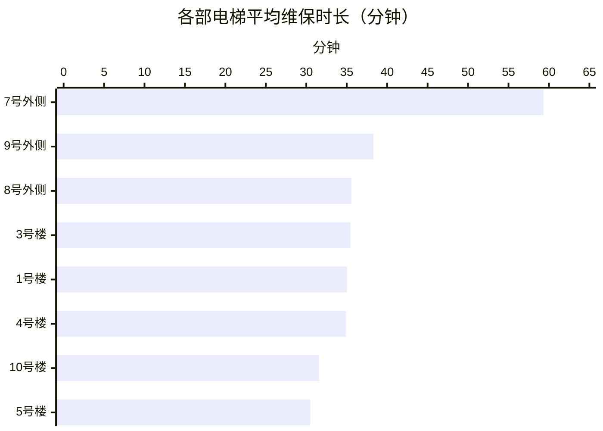
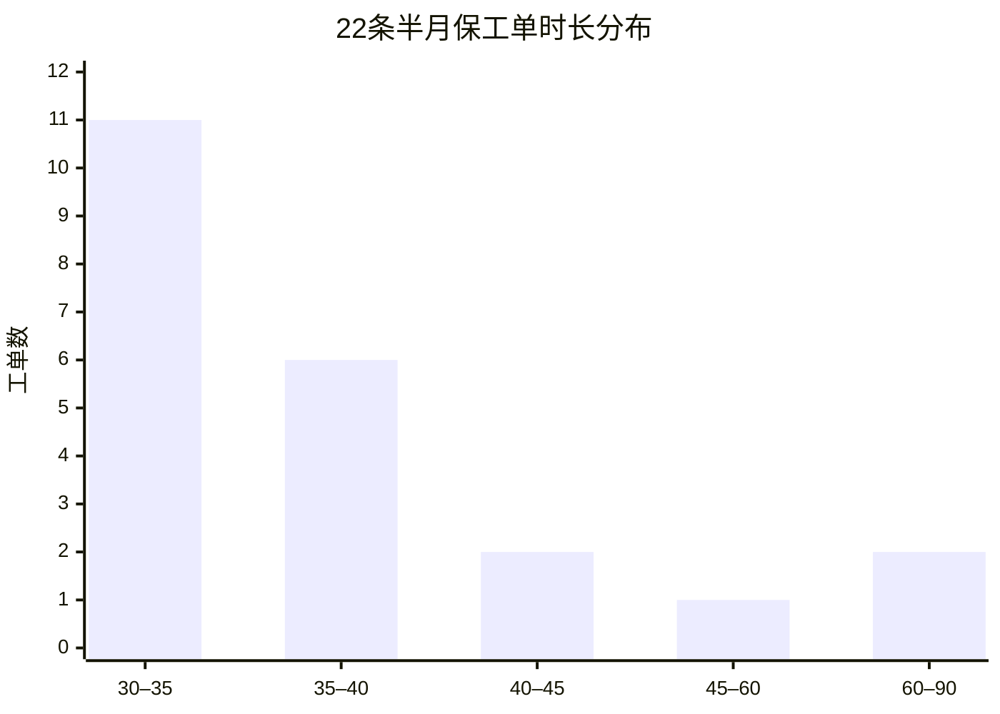
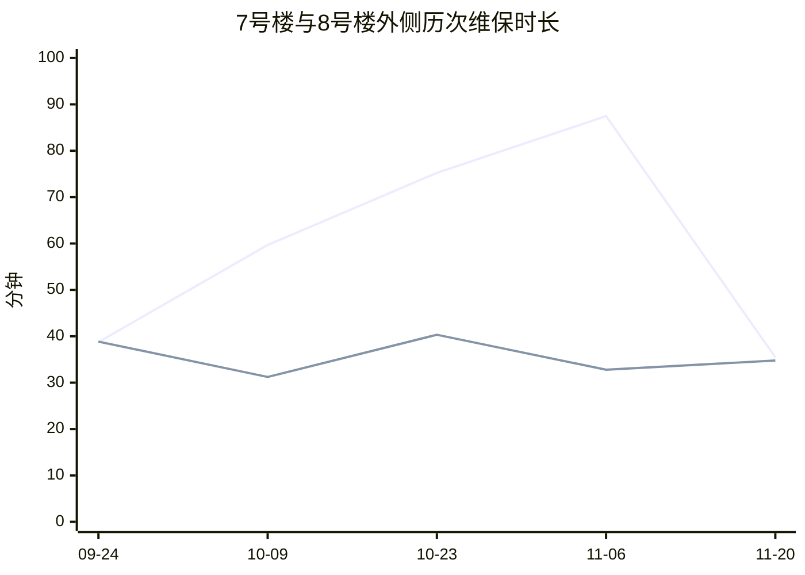
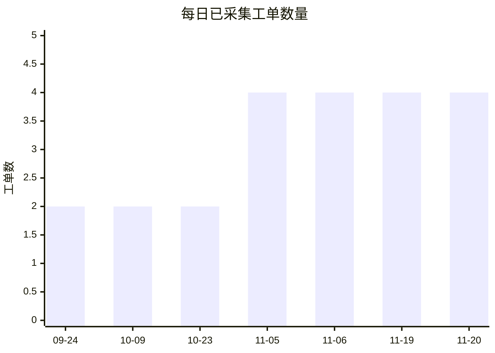
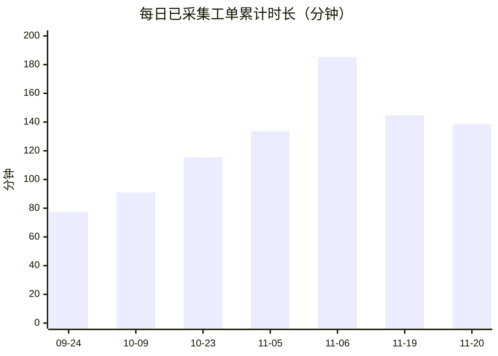
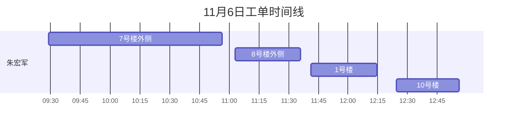
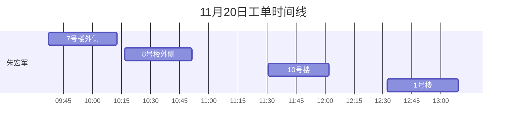

# 紫竹华庭奥的斯电梯维保数据可视化分析

> 数据采集日期：2026-11-28；范围：2026年新装13部奥的斯电梯。
>
> 数据来源：[原始维保记录](./zizhu-otis-maintanence-records.md)。所有时长均为系统工单记录，未独立核实实际作业时长。图表中的小数分钟为秒数除以60后四舍五入至两位小数。

## 1. 调查覆盖率与记录完整性

| 指标 | 数值 |
| --- | ---: |
| 已调查 | 11/13（84.6%） |
| 有记录 | 8部 |
| 系统无记录 | 3部 |
| 待确认 | 2部 |
| 累计工单 | 22条 |
| 登记维保人员 | 1人 |
| 平均单次时长 | 40分17秒 |
| 已采集工单时间重叠 | 0次 |

已调查电梯中，无记录比例为3/11（27.3%）。无记录：2号楼、7号楼内侧、9号楼内侧；待确认：8号楼内侧、11号楼。

## 2. 各部电梯平均维保时长

| 排名 | 电梯 | 样本数 | 平均时长 |
| ---: | --- | ---: | ---: |
| 1 | 7号楼外侧 | 5 | 59:19 |
| 2 | 9号楼外侧 | 2 | 38:18 |
| 3 | 8号楼外侧 | 5 | 35:36 |
| 4 | 3号楼 | 2 | 35:28 |
| 5 | 1号楼 | 2 | 35:02 |
| 6 | 4号楼 | 2 | 34:54 |
| 7 | 10号楼 | 2 | 31:35 |
| 8 | 5号楼 | 2 | 30:31 |

7号楼外侧平均时长较8号楼外侧高约66.3%。排除7号楼外侧后，其余17条工单平均时长34分41秒。各部电梯样本数不同，不宜将该排名直接理解为维保质量排名。

## 3. 维保时长分布

| 时长区间（分钟，左闭右开） | 次数 | 占比 |
| --- | ---: | ---: |
| 30–35 | 11 | 50.0% |
| 35–40 | 6 | 27.3% |
| 40–45 | 2 | 9.1% |
| 45–60 | 1 | 4.5% |
| 60–90 | 2 | 9.1% |

17条（77.3%）集中在30至不足40分钟。最短30分12秒，最长87分28秒。所有工单均超过30分钟，是否存在系统最低时长限制尚无证据。

## 4. 7号楼与8号楼外侧维保趋势

第一条曲线为7号楼外侧，第二条为8号楼外侧。

| 日期 | 7号楼外侧 | 8号楼外侧 | 工单之间间隔 |
| --- | ---: | ---: | ---: |
| 09-24 | 38:45 | 38:51 | 2:31 |
| 10-09 | 59:41 | 31:14 | 2:18 |
| 10-23 | 75:14 | 40:20 | 2:03 |
| 11-06 | 87:28 | 32:48 | 6:36 |
| 11-20 | 35:29 | 34:46 | 3:47 |

两部电梯五次维保日期完全一致。7号楼外侧11月20日比11月6日减少约59.4%；应核实额外检查、维修、暂停或记录口径等可能原因，现有数据无法确定原因。

## 5. 11月份两轮维保横向比较

```mermaid
xychart-beta
    title "11月两轮维保时长对比"
    x-axis ["1号","3号","4号","5号","7号外","8号外","9号外","10号"]
    y-axis "分钟" 0 --> 100
    bar [33.25,32.10,36.62,30.82,87.47,32.80,34.03,31.77]
    bar [36.82,38.82,33.18,30.20,35.48,34.77,42.55,31.40]
```

每组第一柱为11月5–6日，第二柱为11月19–20日。

| 电梯 | 第一轮 | 第二轮 | 变化 |
| --- | ---: | ---: | ---: |
| 1号楼 | 33:15 | 36:49 | +10.7% |
| 3号楼 | 32:06 | 38:49 | +20.9% |
| 4号楼 | 36:37 | 33:11 | -9.4% |
| 5号楼 | 30:49 | 30:12 | -2.0% |
| 7号楼外侧 | 87:28 | 35:29 | -59.4% |
| 8号楼外侧 | 32:48 | 34:46 | +6.0% |
| 9号楼外侧 | 34:02 | 42:33 | +25.0% |
| 10号楼 | 31:46 | 31:24 | -1.2% |

## 6. 每日工单数量与累计时长

| 日期 | 工单数 | 累计时长（分:秒） |
| --- | ---: | ---: |
| 09-24 | 2 | 77:36 |
| 10-09 | 2 | 90:55 |
| 10-23 | 2 | 115:34 |
| 11-05 | 4 | 133:34 |
| 11-06 | 4 | 185:17 |
| 11-19 | 4 | 144:45 |
| 11-20 | 4 | 138:28 |

累计时长只覆盖本小区已取得的工单，不代表该人员全天工作时长或完整工作量。

## 7. 维保记录时间线（11月份）

## 8. 结论及后续核查

- 目前22条工单均显示同一登记人员朱宏军，类型均为半月保，结果均为正常。不能由此确定实际到场人数。
- 已取得的相邻维保记录间隔为14–15天，未发现已采集工单时间重叠。
- 重点核查3部系统无记录的电梯，以及已开通但缺少早期记录的电梯。
- 补齐8号楼内侧及11号楼数据后更新本文件。
- 系统无记录不等于实际未维保；时长差异不等于质量差异。应进一步取得物业原始台账、交接单及维保作业项目记录。
